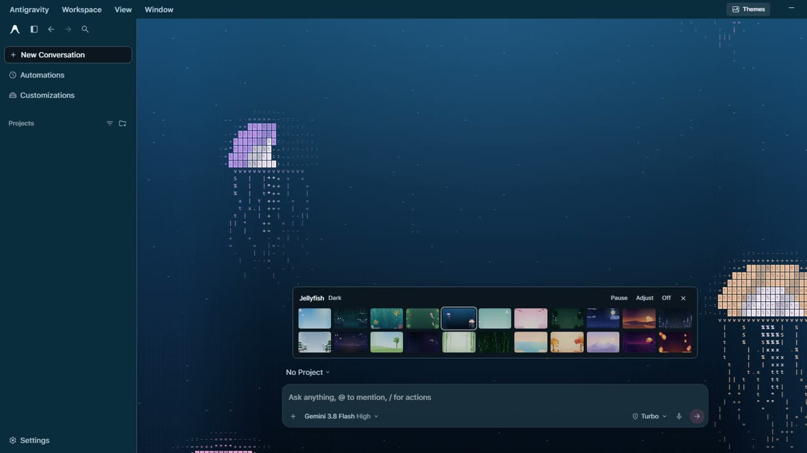
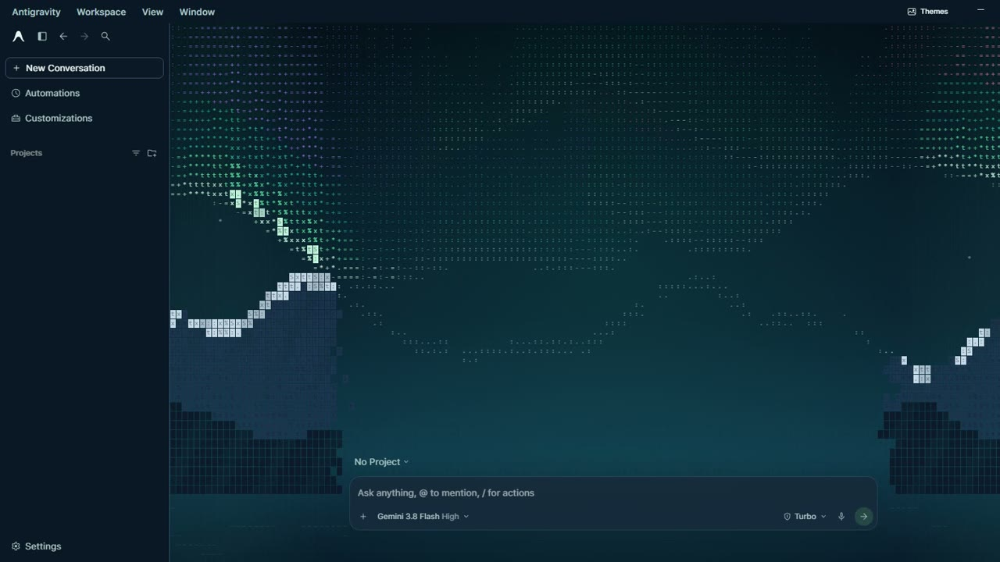
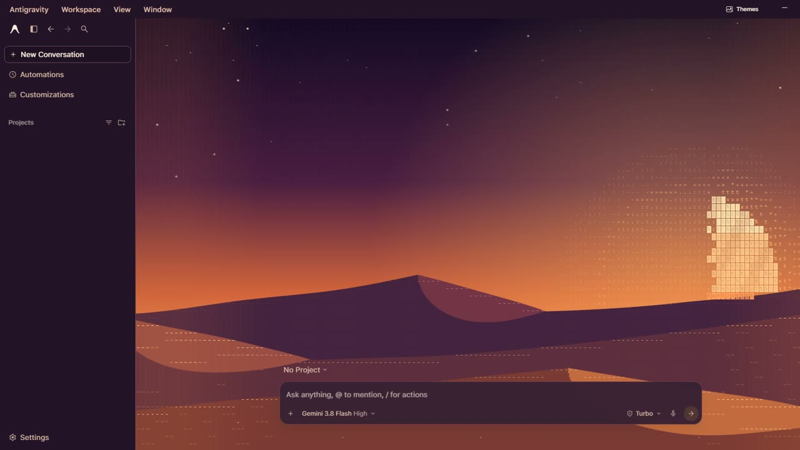
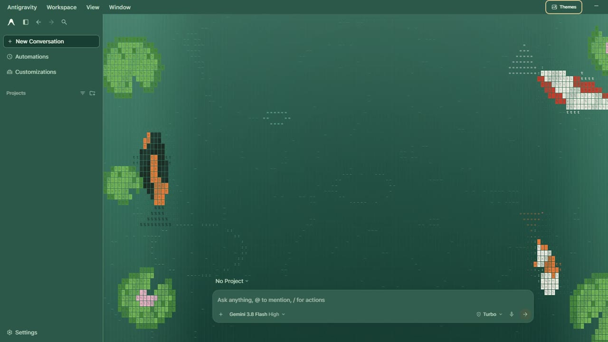
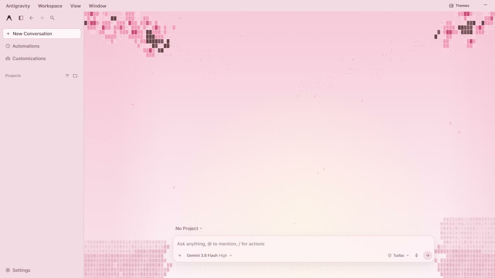
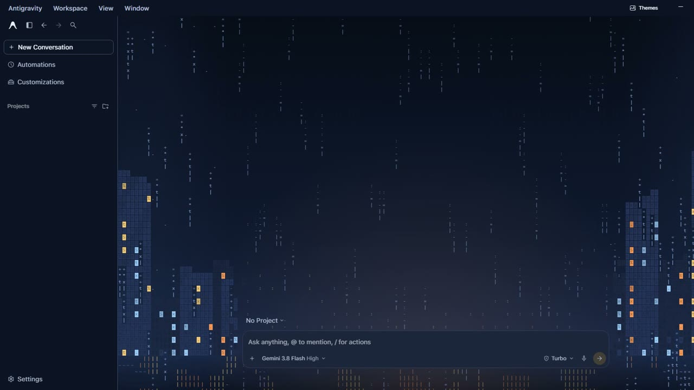
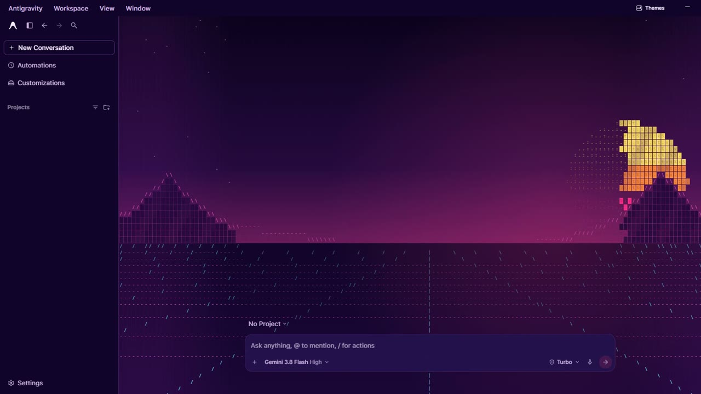

# ASCII Wallpapers for Antigravity

Live, animated backgrounds for the [Antigravity](https://antigravity.google) desktop app, drawn entirely in text characters. 23 themes, a one-click picker, and nothing leaves your machine.

**[Watch the demo and see the themes →](https://mix4o445.github.io/antigravity-ascii-wallpapers/)**



> Unofficial community mod. Not affiliated with or endorsed by Google. It patches your local copy of the app (with a verified backup), so use it at your own risk.

## Features

- **23 live themes**: 9 light and 14 dark. Cloud Drift, Aurora, Honu Lagoon, Koi Pond, Jellyfish, Paper Boats, Sakura, Fireflies, Moonlit, Ember Dunes, Night Rain, Snowfall, Sky Lanterns, Windy Meadow, Spiral Galaxy, Bamboo Grove, Digital Rain, Morning Tide, Autumn Leaves, Alpine Dawn, Retro Sunset, Lava Lamp and Starry Catnap.
- **Whole-app theming (or wallpaper-only)**: the sidebar, menus, composer, title bar and window controls are recolored to match each scene, or uncheck **Adjust → Theme app** to keep Antigravity's stock UI chrome.
- **Three ways to open or switch**: click **Themes** in the top right, press **Ctrl+Alt+W**, or type `/theme` in the composer (including direct commands like `/theme catnap`, `/theme random` or `/theme off`).
- **Controls**: Pause freezes the animation, Adjust sets intensity, glyph style (**ASCII**, **Braille**, **Blocks**, **Katakana**) and grid density (**Fine**, **Normal**, **Chunky**), and Off restores the stock look instantly.
- **Reacts to your agents**: the scene speeds up and brightens while agents are running, with scene-specific touches (Catnap's ear twitches and tail swishes, Digital Rain adds streams, Aurora flares, Koi and Fireflies liven up). When an agent finishes, a ripple spreads out from the composer. If the window was hidden at the time, the ripple plays when you come back. Turn it off under **Adjust → React to agents**.
- **Stays out of the way**: the background sits behind your text and the composer stays fully interactive. Rendering pauses while the window is hidden, and reduced-motion settings are respected.
- **Private**: no network requests. Your pick is saved locally in `%APPDATA%\Antigravity\ascii-wallpapers-preferences.json`.

| | | |
|---|---|---|
|  |  |  |
|  |  |  |

## Requirements

- Windows, with the standalone Antigravity app installed in the default location (`%LOCALAPPDATA%\Programs\antigravity`).
- [Node.js](https://nodejs.org) 18 or newer.

Version **2.28.2** was inspected by hand. Other versions are checked automatically before anything is changed (see [Safety checks](#safety-checks)), and the installer refuses any build that fails them.

## Install

1. Download this repository (**Code → Download ZIP**) and extract it.
2. Close Antigravity completely.
3. Open PowerShell in the extracted folder and run:

   ```powershell
   node .\manage-wallpapers.cjs install
   ```

4. Reopen Antigravity and click **Themes**.

To check that the archive rebuild works on your machine without changing anything, run `node .\manage-wallpapers.cjs verify` first. `node .\manage-wallpapers.cjs status` shows the detected app version, whether wallpapers are installed, and whether the build can be patched.

## After an Antigravity update

Updates replace the app archive, which removes the wallpapers. Close Antigravity and run the install command again:

```powershell
node .\manage-wallpapers.cjs install
```

The installer detects the new build, runs the safety checks, and keeps the old build's backup next to the new one as `app.asar.ascii-wallpapers.backup.<old version>-<timestamp>`. You can delete that file once the new version works.

## Uninstall

Close Antigravity, then run:

```powershell
node .\manage-wallpapers.cjs restore
```

The original archive is kept next to the app as `app.asar.ascii-wallpapers.backup`. Restore checks hashes first and refuses to overwrite a newer app version.

## Safety checks

Before patching a build that wasn't inspected by hand, the installer requires all of the following and changes nothing if any fails:

- `package.json` names the app as Antigravity, with `dist/main.js` as its entry point.
- `dist/preload.js` and `dist/main.js` are packed in the archive and don't already contain the mod.
- The patched `dist/preload.js` and `dist/main.js` compile. This catches syntax or name clashes with the new app code.
- Electron's `EnableEmbeddedAsarIntegrityValidation` fuse is off in `Antigravity.exe`. If it is on, any edited archive would stop the app from launching.

It also prints a note if an optional hook is missing. In that case only that feature stops working: saved preferences, title bar colors, or agent reactivity.

## How it works

The installer appends the wallpaper scripts to Antigravity's `dist/preload.js` and `dist/main.js` inside `app.asar`, rebuilds the archive, and updates every integrity hash. It then re-verifies every packed file before replacing the archive. It runs through the app's existing isolated preload: Node integration and context isolation stay as shipped.

Agent reactivity uses the running-agent count that Antigravity already sends from the page to the main process for its tray menu (`agent:update-active-count`). The preload watches that call as it passes through. It doesn't read the page or your conversations.

| File | Purpose |
|---|---|
| `wallpaper-scenes.js` | The 23 scene renderers |
| `ascii-wallpapers.js` | Theme definitions, picker UI and app recoloring |
| `wallpapers-main.js` | Saves your preferences in the main process |
| `manage-wallpapers.cjs` | Install, verify, status and restore |

## License

MIT. See [LICENSE](LICENSE).
